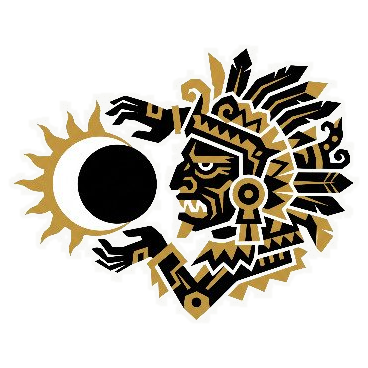

<div align="center">
  
  <h1>Tzi Tzi Labs — Official Website</h1>
  <p><strong>Experimental indie games crafted with passion and creativity.</strong></p>
  <p>
    <a href="https://tzitzilabs.github.io/">🌐 Website</a> •
    <a href="https://tzitzilabs.itch.io/">🎮 itch.io</a> •
    <a href="https://x.com/TziTziLabs">🐦 X (Twitter)</a> •
    <a href="https://www.instagram.com/tzitzilabs/">📸 Instagram</a>
  </p>
</div>

---

## 📖 Overview / Descripción General

**EN:** Official website repository for **Tzi Tzi Labs**, an independent game studio dedicated to experimentation, creativity, and unique interactive experiences. Built with lightweight, dependency-free HTML5, CSS3, and Vanilla JavaScript for optimal performance, full WCAG 2.1 AA accessibility, multilingual support, and integrated Web Vitals telemetry.

**ES:** Repositorio del sitio web oficial de **Tzi Tzi Labs**, un estudio de videojuegos independiente enfocado en la experimentación, la creatividad y experiencias interactivas únicas. Desarrollado con HTML5, CSS3 y JavaScript Vanilla sin dependencias externas para lograr el máximo rendimiento, accesibilidad WCAG 2.1 AA, soporte multilenguaje y telemetría Web Vitals integrada.

---

## ✨ Key Features / Características Principales

- 🎨 **Adaptive Dark & Light Themes**: Custom gold-and-obsidian palette with automatic sketch inversion and persistent preference in `localStorage`.
- 🌍 **Multilingual (i18n & RTL Support)**: Dynamic translation and localized SEO metadata across **6 languages**:
  - English (`en`), Español (`es`), Français (`fr`), Português (`pt`), 中文 (`zh`), and עברית (`he` with native Right-to-Left layout).
- ♿ **Accessibility (WCAG 2.1 AA + Interactive Widget)**:
  - Interactive accessibility menu in the navigation bar:
    - **Text Scaling**: `100%`, `115%`, `130%`
    - **High Contrast Mode**: Enhanced contrast and borders for both dark and light themes
    - **Readable Font Mode**: Clean sans-serif typography (`Inter`) with extra spacing for dyslexia readability
    - **Underline Links & Reduce Motion**: Instant toggles persisted per user
  - Semantic landmarks (`<main>`, `<nav>`, `<header>`, `<footer>`), keyboard `.skip-link`, high-visibility `:focus-visible` rings, and live screen-reader announcements (`aria-live="polite"`).
- 📊 **Built-in Metrics & Web Vitals Dashboard**:
  - Real-time monitoring of **Core Web Vitals**: First Contentful Paint (`FCP`), Largest Contentful Paint (`LCP`), Cumulative Layout Shift (`CLS`), and DOM load time.
  - Engagement tracking: Page views, active session time, maximum scroll depth, section visibility (`IntersectionObserver`), and outbound CTA/social clicks (`itch.io`, `X`, `Instagram`).
  - Interactive modal accessible via the **Metrics** button or `Alt + M` shortcut, with **JSON Export** and data reset capabilities.
  - Automatic event forwarding ready for Google Analytics 4 (`gtag`), Plausible, or GoatCounter.

---

## 📁 Project Structure / Estructura del Proyecto

```text
tzitzilabs.github.io/
├── assets/
│   ├── favicon.png       # 64x64 studio icon
│   ├── hero-bg.png       # Transparent rooster & sun sketch illustration
│   └── logo.png          # High-contrast Tzi Tzi Labs emblem
├── css/
│   └── style.css         # Theme variables, responsive layout, RTL, a11y & modal styles
├── js/
│   ├── main.js           # Theme switcher, i18n engine, mobile nav & accessibility widget
│   ├── metrics.js        # Core Web Vitals observer, engagement telemetry & JSON exporter
│   └── translations.js   # Dictionary for EN, ES, FR, PT, ZH, and HE
├── index.html            # Main entry point with semantic landmarks & Open Graph metadata
├── LICENSE               # Project license
└── README.md             # Project documentation
```

---

## 🚀 Local Development / Desarrollo Local

No build step or package manager is required. You can preview the site using any static file server:

```bash
# Python 3
python -m http.server 8080

# Node.js (npx)
npx serve .
```

Then open `http://localhost:8080` in your browser.

---

## 📄 License

Distributed under the terms specified in [LICENSE](LICENSE).  
© Tzi Tzi Labs. All rights reserved.
